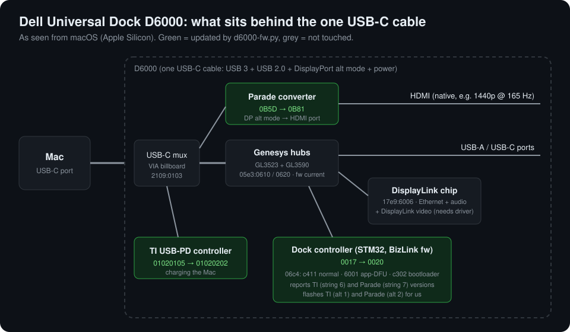
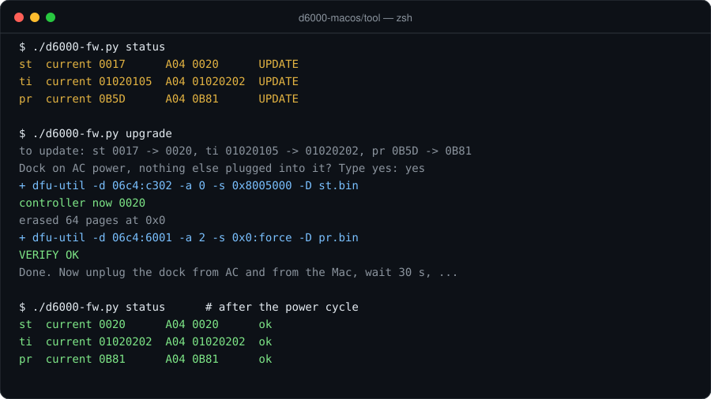
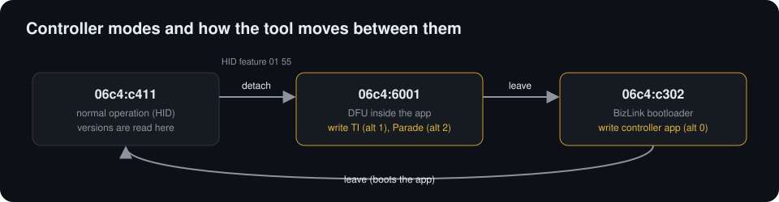

# d6000-macos

**Update Dell Universal Dock D6000 firmware from macOS — no Windows needed.**

Dell ships the D6000 firmware updater (A04) for Windows only. This repo reverse engineers what it does and repeats it on macOS (Apple Silicon tested) with `dfu-util`, plus a small tool that "replugs" the dock in software.



| Part | Firmware before | After (A04) | Status |
|---|---|---|---|
| Dock controller (STM32) | 0017 | **0020** | ✅ works |
| TI USB-PD controller | 01020105 | **01020202** | ✅ works, verified by readback |
| Parade video converter (HDMI) | 0B5D | **0B81** | ✅ works, verified by readback ([the erase trap](#parade-converter-the-dfu-util-erase-trap)) |
| Genesys GL3523 hubs (`05e3:0610/0620`) | 8816 / 8817 | 8816 / 8817 | ✅ already the A04 version |
| Genesys hub `05e3:0626` | 0663 | — | ✅ A04 has no firmware for it |
| DisplayLink chip (Ethernet, audio, DisplayLink video) | 31.54 | — | ℹ️ not part of A04, updated by the DisplayLink driver |

`status` reports every one of these chips, so after an update you can see at a glance that nothing is left.

> [!WARNING]
> Flashing firmware can brick your dock. Dell users report bricked D6000s even with Dell's own tool. Read the whole README first, keep the dock on its power brick, and do not unplug anything while a write is running. No warranty, see [LICENSE](LICENSE).

## Contents

- [Is your dock really broken? (macOS USB accessory security)](#is-your-dock-really-broken)
- [Quick start](#quick-start)
- [How it works](#how-it-works)
- [Software replug](#software-replug)
- [Parade converter: the dfu-util erase trap](#parade-converter-the-dfu-util-erase-trap)
- [How this was reverse engineered](#how-this-was-reverse-engineered)
- [Legal](#legal)

## Is your dock really broken?

Before touching firmware: on Apple Silicon a dock that "half works" (USB devices gone, Ethernet still up, or the whole dock missing after a reboot) is often **macOS blocking the accessory**, not the dock.

```sh
log show --last 15m --predicate 'eventMessage CONTAINS "transport restrictions"'
```

Any hit (`createDevice: device identification blocked by transport restrictions`) means macOS refused the dock. Fix it:

1. Unplug the dock's USB-C cable and plug it back in **while the Mac is unlocked**, then click **Allow**.
2. To stop it happening again: **System Settings → Privacy & Security → Wired Accessories → "Allow accessories to connect" → "Automatically allow when unlocked"**.

At the login screen (before the first unlock) dock devices stay blocked, so a keyboard on the dock won't work there. Use the built-in or a Bluetooth keyboard.

## Quick start

Requirements: macOS on Apple Silicon, [Homebrew](https://brew.sh), Python 3, Xcode Command Line Tools (only for the replug tool).

```sh
brew install dfu-util libusb sevenzip
git clone https://github.com/y0rune/d6000-macos && cd d6000-macos/tool
python3 -m venv .venv && .venv/bin/pip install -r requirements.txt
export DYLD_LIBRARY_PATH=/opt/homebrew/lib     # lets pyusb find Homebrew's libusb
PY=".venv/bin/python -I d6000-fw.py"

$PY fetch      # download Dell's A04 package, verify SHA-256, unpack the .dfu files
$PY extract    # write st.bin / ti.bin / pr.bin (raw images, see "How it works")
$PY status     # current versions vs A04 (read-only)
$PY upgrade    # the whole update: asks once, then walks the controller through all modes
```

Example `status` before the update:

```
st  current 0017      A04 0020      UPDATE
ti  current 01020105  A04 01020202  UPDATE
pr  current 0B5D      A04 0B81      UPDATE
DFU devices: none
```

Disconnect everything from the dock except power and the USB-C cable to the Mac, then run `upgrade`. It reads the versions, picks only the outdated parts, asks for a single `yes`, and then does what the manual steps below do, checking the USB identity after every step.



<sub>Real output from the update of one dock, condensed (dfu-util progress lines removed; the controller was updated in an earlier run).</sub>

Manual steps, **one at a time**, checking `status` after each:

```sh
$PY detach       # controller -> DFU mode, shows up as 06c4:6001 after ~3 s
$PY leave 6001   # -> bootloader 06c4:c302
$PY flash st     # write the controller app (only allowed on c302)
$PY leave c302   # boots the new controller firmware: status shows st 0020
$PY detach       # -> 06c4:6001 again; wait ~8 s
$PY flash ti     # write TI PD firmware, then read back and compare
$PY flash pr     # erase 64 x 1 KiB sectors, write Parade firmware, read back and compare
$PY leave 6001   # -> c302
$PY leave c302   # -> back to normal
```

Finally **unplug the dock from AC power and from the Mac, wait 30 s and plug it back in** (power first). The TI chip loads its new firmware only at power-up. `status` should then show `st 0020`, `ti 01020202` and `pr 0B81`.

While the controller is in DFU mode the dock's HDMI output may drop to a low resolution. It comes back after `leave` and a cable replug.

## How it works

The dock controller is an STM32 running BizLink firmware (BizLink is the dock's ODM). It has three USB identities:



| VID:PID | Mode | What can be written |
|---|---|---|
| `06c4:c411` | normal operation, HID device | nothing; versions are read here |
| `06c4:6001` | DFU mode inside the running app | alt 1 TI SPI flash `@0x09000000`, alt 2 Parade flash `@0x0` |
| `06c4:c302` | BizLink bootloader | alt 0 internal flash (controller app) |

- **Versions:** controller = USB `bcdDevice` of `c411`; TI = USB string descriptor 6; Parade = string descriptor 7. Dell's tool reads the same values from a UsbTreeView dump.
- **Detach:** a HID feature report on vendor usage page `0xFF00`: `[0x01, 0x55]` (report ID 1, value `0x55`), as in ST's DfuSe-over-HID scheme.
- **Leave:** a standard DfuSe "leave" (`dfu-util -s 0x08000000:leave`): from `6001` it goes to the bootloader `c302`, from `c302` it boots the app.
- **Controller image:** `ST0020.dfu` covers `0x08000000–0x0801FFFF`, but the first 20 KiB are the bootloader in read-only pages. The tool writes bytes `0x5000…` to `0x08005000` (110 592 bytes, no FF trimming: a 256-byte signature sits at the end). The bootloader does not support reading flash back, so the controller write is proven by the version it reports after `leave c302` (Dell does not verify it either).
- **Raw images:** the `.dfu` files carry PID `c411` in their suffix, so `dfu-util` would refuse them on `6001`/`c302`. `extract` writes plain `.bin` files instead.
- **Safety checks in `d6000-fw.py`:** a write only starts when exactly the right DFU PID is present. Writing alt 0 from `6001` would overwrite the running app, so the tool refuses. TI and Parade are read back and compared byte for byte.

## Software replug

`tool/d6000-replug.swift` does what pulling the USB-C cable does: it re-enumerates the dock's top-level Genesys hub (`05e3:0610`), and macOS rebuilds the whole dock (USB 2.0 and USB 3 trees, Ethernet) in about a second.

```sh
swiftc -O tool/d6000-replug.swift -o /usr/local/bin/d6000-replug
sudo d6000-replug
```

It needs root, because it opens the hub with `IOUSBHostDevice` device capture and calls `reset()`. libusb/pyusb `reset()` does not work on hubs on macOS (ENODEV, even as root). Resetting only the USB 3 side (`05e3:0620`) left the USB 2.0 devices missing, which is why the tool resets `0610` first.

## Parade converter: the dfu-util erase trap

The Parade alt reports the memory layout `/0x00000000/0*001Ka,64*001Kg`: a zero-page read-only segment, then 64 writable 1 KiB sectors, both starting at `0x0`.

- `dfu-util` 0.11 matches address `0x0` to the empty read-only segment. It refuses the download (`Last page at 0x0000ffff is not writeable`), and with `-s 0x0:force` it writes **without erasing anything**.
- The controller silently drops writes to flash that was not erased. Every DFU status says "OK", yet the chip keeps its old firmware.
- Dell's updater (ST DfuSe) erases every sector of the mapping first. `d6000-fw.py` does the same: it sends the DfuSe erase command (`DFU_DNLOAD` block 0, payload `0x41` + 32-bit address) for each 1 KiB sector, polls `DFU_GETSTATUS` until the sector is done, aborts back to `dfuIDLE`, and only then lets `dfu-util -s 0x0:force` write.

After that, the readback matched the file byte for byte, and after a power cycle the chip reported `0B81`.

## Every chip in the dock

| Chip | USB ID | How its firmware gets updated |
|---|---|---|
| Dock controller (STM32) | `06c4:c411` | `d6000-fw.py` (A04 `ST0020`) |
| TI USB-PD controller | via the controller | `d6000-fw.py` (A04 `TI01020202`) |
| Parade converter (HDMI) | via the controller | `d6000-fw.py` (A04 `PR0B81`) |
| Genesys GL3523 hubs ×2 | `05e3:0610` / `0620` | Dell ships ROMs `GL18816`/`GL28817` and flashes them with Genesys' Windows-only ISP tool. The version sits at offset `0x10e` of each ROM and the hub reports it as `bcdDevice`, so `status` can compare them. |
| Genesys hub | `05e3:0626` | No firmware in A04. |
| Genesys GL3590 | `05e3:0625` | A04 ships `HUB17054`/`HUB27061` for it, but the D6000 tested here does not contain this chip (most likely the D6000S variant). `status` compares it when present. |
| DisplayLink | `17e9:6006` | Not in A04. The DisplayLink driver (DisplayLink Manager on macOS) updates it. It only matters for monitors on the dock's DisplayLink ports. Ethernet, audio and USB work without the driver. |

## How this was reverse engineered

1. **Package:** `Dock_D6000_FW_Updater_A04_F1TXX.exe` (SHA-256 `3bd53ba3…edcc50ab`, Authenticode-signed by BizLink, `osslsigncode verify` passes) is a self-extracting archive (`7zz x`). Inside: `D6000Updater.exe`, ST's `STDFU*.dll`, the `dfu/*.dfu` images and Genesys hub tools.
2. **Images:** all `.dfu` files are standard ST DfuSe files (one target, one element, valid CRC) for alt 0 (controller), alt 1 (TI) and alt 2 (Parade).
3. **Updater:** `D6000Updater.exe` is a debug MFC build of ST's DfuSe Demo 3.0.5 (HID variant), so it decompiles cleanly with [radare2](https://github.com/radareorg/radare2) + [r2ghidra](https://github.com/radareorg/r2ghidra). Key functions (VA):
   - `0x45bcf0`: HID detach (finds the feature report on usage page `0xFF00`, sends `0x55`).
   - `0x4429d0`: builds a bitmask of parts to update. A part is flashed when its version **string differs** from the version in the file name. If TI < `0x01020103`, a temporary controller firmware (`TEMP0015`) is flashed first to bridge the TI update; not needed for TI `01020105`.
   - `0x442ee0`: stage state machine: controller → TI → Parade → hubs.
   - `0x441250`: per-stage download (file name + DFU alt).
4. **Device side:** the USB descriptors and the DFU alt names (`dfu-util -l`) confirmed the decompiled logic: the PIDs, the flash layouts and the version strings.

## Legal

*Not legal advice.*

- This repo contains **only original code and documentation**. It does **not** include Dell's firmware, updater or DLLs. `d6000-fw.py fetch` downloads the official package from Dell's own CDN, and you accept Dell's terms by using it.
- The reverse engineering was done for **interoperability** (running the update on macOS), which EU law (Directive 2009/24/EC, Art. 6) and US law (DMCA §1201(f)) both specifically allow. The README describes behaviour and function addresses and contains no copied Dell code.
- "Dell" and "D6000" are trademarks of Dell Inc., used here only to name the hardware. This project is not affiliated with or endorsed by Dell, BizLink, ST, TI, Parade or Genesys.
- Flashing firmware is at your own risk and may void your warranty.

## License

[MIT](LICENSE)
